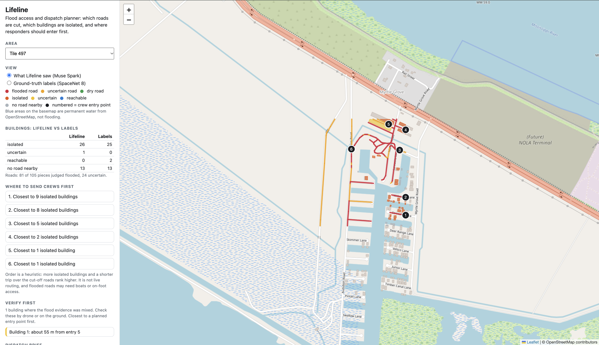

# Lifeline
**Who's cut off by the flood, and where do crews go first?**

Flood access and dispatch planner. From before and after satellite photos and a road network, Lifeline works out which roads are cut, which buildings are isolated, and where responders should enter first. It writes a cited dispatch brief, and an "Ask the map" assistant answers typed or spoken questions using only the results.

Built for the Meta Global AI Developer Hackathon (Indie track, solo).

- **Live map:** https://bhavishyamangalasary.github.io/lifeline/
- **Demo video:** [VIDEO URL]



**Results at a glance** (15 random, heavily flooded SpaceNet 8 tiles, 639 truly cut-off buildings)
- 90% were called isolated, 9% uncertain (sent to a verify queue), and 1 building (0.2%) was called reachable.
- "Isolated" calls were right 98% of the time here, against 88% for calling everything isolated, and only 42% to 53% on less flooded tiles.
- The cost of caution: about 15% of buildings (112 of 725) went to the verify queue, and 52 of those were actually reachable.

## The problem
After a flood, the urgent question is not only "where is the water" but "who can no longer get out, and where can a crew get in". A road that is under water cuts every building behind it. Lifeline turns a before and after photo pair and a road network into an answer to that question, and is explicit about what it is unsure of.

## How it fits together
```
before + after photos, road network
        |
        v
Muse Spark judges each road piece (two modes)  ->  flooded / dry / uncertain
        |
        v
Road graph: which buildings lost their route to an exit
(run twice, optimistic and pessimistic)        ->  isolated / reachable / uncertain
        |
        v
Ranked entry points for responders
        |
        +--> Cited dispatch brief (each sentence cites a fact; numbers are checked)
        +--> Ask the map: typed or spoken questions, citations checked
        +--> Map page with an audit toggle against ground truth
```

## What it does
1. **Judges flood damage per road piece.** Muse Spark looks at a small crop around each road piece in two modes (after-photo only, and before and after side by side). If both say flooded, the piece is flooded. If both say dry, it is dry. If they disagree, it is marked **uncertain**.
2. **Plans access.** It builds a road graph and finds buildings that could reach an exit before the flood but cannot now. It runs the plan twice, optimistic and pessimistic, so each building is called isolated, reachable, or **uncertain**.
3. **Ranks where crews should enter.** Entry points are ranked by how many isolated buildings they serve, with a shorter trip ranking higher. This is a heuristic, not live routing.
4. **Writes a dispatch brief.** Each sentence cites a numbered fact, and a checker rejects sentences whose numbers do not appear in the cited facts.
5. **Ask the map.** Type or speak a question. Muse Voice transcribes speech, and Muse Spark answers by calling tools over the exported results and citing evidence IDs. A checker flags any citation the model did not actually get from a tool.
6. **"Verify first" queue.** Buildings the system is unsure about are listed, closest to a planned entry point first, for a drone or ground check.
7. **Audit toggle.** The map can switch between what Lifeline saw and the ground-truth labels, with a table comparing building counts for each tile.

## Meta tools used
| Tool | Role |
|---|---|
| **Meta Model API, Muse Spark** (`muse-spark-1.3`) | Flood judgement from images, dispatch brief writing, and the Ask-the-map agent with tool calling |
| **Muse Voice** (`muse-voice-transcribe-1.0`) | Spoken questions for Ask the map, using the realtime speech-to-text endpoint (live local version only) |
| **SAM 3.1** | Tested as a flood detector. With my prompts on 5 tiles it found only large open water and returned no matches on flooded land, so it is not used in the pipeline. This is a negative result, reported as such. |

<details>
<summary><b>How it works in detail</b></summary>

**Data.** SpaceNet 8, Louisiana East (Hurricane Ida). Each tile is a 1300 x 1300 pixel image (about 0.45 m per pixel) with road and building outlines in pixel coordinates. Post-event images vary in size but cover the same area, so they are resized to the pre-event frame. Geographic coordinates come from the pre-event image.

**Flood judging.** For each road piece, a 320 pixel window around it is cropped, the piece is drawn in cyan, and the crop is upscaled 2x. Muse Spark returns JSON with a flooded flag, a confidence and a reason. The prompt follows the dataset's definition of a flooded road (visibly covered with water or rubble), phrased as "visibly covered by floodwater, mud or debris". Results are cached on disk, and calls run in parallel.

**Access planning.** Road pieces become graph edges. Exits are graph nodes within 3 pixels of the tile border. A building attaches to the nearest road piece within 80 pixels. A building is isolated if its piece could reach an exit before the flood but cannot now. The plan runs on an optimistic reading (only confident floods block roads) and a pessimistic reading (uncertain roads also block). Isolated under both is isolated, reachable under the pessimistic is reachable, and the rest is uncertain.

**Dispatch.** Entry points are the dry network nodes closest to isolated buildings (shortest path over road travel times). Entries are grouped, and ranked by buildings served divided by trip time plus one minute. This is a heuristic.

**Brief.** The brief is generated from numbered facts (road counts, building counts, entry points, reliability, limitations). A checker requires a citation on every sentence and that every number in the sentence appears in the cited facts.

**Ask the map.** The agent has four tools: `list_tiles`, `tile_summary`, `dispatch_priorities` and `known_limits`. Every tool result carries an evidence ID. After the answer, a checker compares the model's citations with the evidence IDs its tool calls actually returned, and flags any that do not match. The ground-truth labels are hidden from the agent.
</details>

## How well does it work?
Tested against SpaceNet 8 ground-truth labels. The same planner runs on the labels and on Lifeline's judgements, so the comparison measures the flood judgements.

| 15 random tiles: 639 truly cut-off buildings | Count | Share |
|---|---|---|
| Called isolated | 578 | 90% |
| Called uncertain (sent to verify) | 60 | 9% |
| Called reachable (missed) | 1 | 0.2% |

"Missed" means called reachable. Uncertain buildings are flagged for a check, so 638 of 639 were flagged and 578 were confidently called isolated. On 5 earlier tiles used while developing the method, 0 of 27 cut-off buildings were called reachable, which gives 1 of 666 across all 20 tiles.

The prompts were developed on a handful of earlier tiles and frozen before the 15 tiles were picked. The 15 tiles are separate from them. After they were picked, the only code changes were guards against empty or degenerate data (buildings or roads with empty geometry, a road network with no usable starting points); the prompts and the isolation and uncertain rules were not changed.

**Precision** (share of "isolated" calls that were right):
- 98% on the 15 heavily flooded tiles. Calling everything isolated would score 88% there, so Lifeline is about ten points better than that baseline.
- 42% to 53% on 5 earlier tiles where most buildings could still get out (baseline not computed for these tiles).

**The reachable side.** Of the 86 truly reachable buildings in the 15 tiles, 23 were cleared, 52 were left uncertain and 11 were wrongly called isolated. In total, 112 of 725 buildings (about 15%) went to the verify queue, and 52 of those were actually reachable. Lifeline is deliberately cautious: missing a cut-off building costs more than an extra check.

<details>
<summary>Per-tile breakdown (15 random tiles)</summary>

| Tile | Truly isolated | Called isolated | Correctly isolated |
|---|---|---|---|
| 17 | 2 | 2 | 2 |
| 83 | 16 | 17 | 16 |
| 115 | 9 | 11 | 9 |
| 193 | 78 | 73 | 73 |
| 284 | 140 | 140 | 140 |
| 297 | 47 | 47 | 47 |
| 298 | 0 | 0 | 0 |
| 299 | 0 | 0 | 0 |
| 338 | 29 | 27 | 27 |
| 371 | 3 | 3 | 3 |
| 374 | 67 | 63 | 63 |
| 430 | 96 | 95 | 95 |
| 482 | 143 | 95 | 95 |
| 503 | 7 | 15 | 7 |
| 541 | 2 | 1 | 1 |

Truly isolated buildings that were not called isolated were marked uncertain, except one on tile 541, which was called reachable. That is the single miss. Most uncertain calls are on tile 482 (48 of 60), and most wrongly isolated calls are on tile 503 (8 of 11).
</details>

## Limitations
- The 15 tiles were picked at random from tiles with at least 5 flooded road pieces, so they are heavily flooded by design.
- Buildings are clustered inside tiles, so the evidence is closer to 20 areas than to 666 independent cases. The one miss is on tile 541, a small tile with 2 truly cut-off buildings.
- SpaceNet labels a building as flooded when water is in close proximity. That is a proxy, not a field survey.
- One region and one event. Not tested elsewhere.
- Flood judgements are not field-verified. Flooded roads may need boats or on-foot access.
- Entry-point ranking is a heuristic and has not been validated against any outcome. The labels say which buildings are cut off, not where a crew should enter.
- Tile 482 sent 48 of its 143 truly cut-off buildings to uncertain, and tile 503 over-called isolated (8 of the 11 wrong calls). I have not diagnosed why.
- The verify queue is a real workload (about 15% of buildings in these tiles) and has not been tested with an actual response team.
- The checks are mechanical. The brief checker requires a citation on each sentence and that every number appears in the cited fact. The Ask-the-map check confirms that cited evidence IDs came from tool calls. Neither verifies a non-numeric claim, such as which entry point serves the most buildings.
- The public map shows recorded Ask-the-map answers. The live assistant, including voice, runs locally.

## What I learned
- **Muse Spark works as a per-road judge when asked a narrow question.** I give it a crop around one road piece, with the piece marked, instead of asking about a whole photo. My first prompts missed flooded roads because the wording ("water") did not match the dataset's definition (water or rubble). Matching the definition improved results.
- **The two photo modes fail in opposite ways.** On 3 mixed development tiles (170, 542 and 466: 187 road pieces, 86 flooded and 101 dry), the after-photo-only mode caught 49 of 86 flooded pieces (57%) and correctly cleared 76 of 101 dry ones (75%). The before-and-after mode caught 84 of 86 (98%) but cleared only 53 of 101 dry ones (52%). The two modes agreed on 68% of pieces, and were right 80% of the time when they agreed (both dry: 54 pieces, 96% correct; both flooded: 73 pieces, 67% correct). So disagreement became a first-class "uncertain" state instead of a forced guess. (Reproduce with `scripts/10_eval_muse.py` and `scripts/11_confidence.py`.)
- **SAM 3.1 did not detect shallow floodwater in my tests.** With my prompts on 5 tiles it found large open water but returned no matches on flooded land, so I left it out of the pipeline. Other prompting approaches might do better.
- **Judge decisions, not pixels.** The thing a dispatcher needs is "is this building cut off", so I evaluated at that level against label-derived truth. A small road error can change many buildings, and precision depends strongly on how flooded the area is, which is why I report it by flood level.
- **Language models need guardrails in an operations setting.** Briefs and answers are built from numbered facts, and checkers reject uncited sentences or citations the model did not get from a tool. In my tests, Meta's content filter sometimes rejected instruction-heavy system prompts, so instructions are placed in the user message.

## Design choices
- **"Uncertain" is a real answer.** A building that is isolated only under the pessimistic reading goes to the verify-first queue instead of being forced into a yes or no.
- **Cautious by design.** Missing a cut-off building costs more than an extra check, so the system leans towards flagging.
- **The agent never sees the ground truth.** The labels are used only for evaluation and for the audit toggle on the map.
- **Recorded answers on the public page, live agent locally.** The public site cannot hold an API key, so it shows recorded answers from the real agent and says so.

## Run it yourself
```bash
git clone https://github.com/BhavishyaMangalasary/lifeline.git
cd lifeline
python -m venv .venv && source .venv/bin/activate
pip install -r requirements.txt
```
Python 3.13 was used. Create a file named `.env` containing your Meta Model API key:
```
MODEL_API_KEY=your_key_here
```
Then start the local server (it serves the map and a live "Ask the map" box):
```bash
python scripts/20_serve.py
```
Open http://localhost:8000. Click **Speak** to ask by voice (use Chrome and allow microphone access, and keep questions to a few seconds). The exported results in `app/data` are included, so the map and the assistant work without the satellite imagery.

Run the tests with `python -m pytest tests`.

To rebuild results from scratch you need the SpaceNet 8 Louisiana-East training data, which is not included in this repository. It is public on AWS (bucket `spacenet-dataset`):
```bash
mkdir -p data
aws s3 cp --no-sign-request \
  s3://spacenet-dataset/spacenet/SN8_floods/tarballs/Louisiana-East_Training_Public.tar.gz data/
tar -xzf data/Louisiana-East_Training_Public.tar.gz -C data/
```
It is about 3.1 GB, and the scripts expect it under `data/`.

The scripts in `scripts/` are numbered in the order they were used: `13_export.py` writes the tile exports, `14_brief.py` writes briefs, `12_eval_decision.py` runs the evaluation, `18_per_tile.py` prints the per-tile breakdown, `19_record_ask.py` records the public Ask-the-map answers, and `20_serve.py` runs the live local server.

## Repository layout
- `src/lifeline/geo`: road graph, isolation and dispatch planner, label loading, export
- `src/lifeline/perception`: Muse Spark flood judging (and the SAM client used in the negative result)
- `src/lifeline/agent`: dispatch brief with checks, the Ask-the-map agent, and voice transcription
- `app/`: the static map page and exported data (deployed to GitHub Pages)
- `tests/`: planner and parsing tests
- `scripts/`: numbered scripts for each step, evaluation and the local server

## Data and credits
- Road and building outlines, and the satellite imagery used for testing, come from **SpaceNet 8** (Hänsch et al., CVPRW 2022). SpaceNet was accessed in November 2026 from https://registry.opendata.aws/spacenet. Imagery is not redistributed. The tile exports in `app/data` are derived from the SpaceNet 8 road and building outlines and Lifeline's own results; they are included only so the map and assistant run without the imagery. Their terms follow the SpaceNet dataset licence, which I could not confirm; if you hold rights to this data and want it removed, please open an issue.
- Basemap: OpenStreetMap contributors.
- Models: Meta Muse Spark, Muse Voice and SAM 3.1 via the Meta Model API.
- Code in this repository is released under the MIT licence.

## Contributors
- Bhavishya Mangalasary (solo, Indie track)
